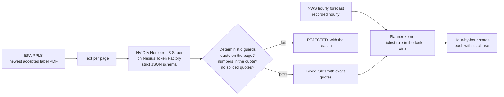

# Labelhand

[](https://github.com/StephenSook/labelhand/actions/workflows/ci.yml)


**Every label in the tank, checked against the forecast, one hour at a time.**

A cotton grower defoliating in Georgia sprays a tank mix of two or three products. Each product's EPA label sets its own wind limit, rain-free period, inversion rule, buffers and release height, and federal law makes using a pesticide in a manner inconsistent with its labeling unlawful (FIFRA, 7 U.S.C. 136j(a)(2)(G)). The applicator is supposed to hold all of those labels in their head and match them against the weather.

Labelhand reads the full EPA label of every product in the tank and turns each restriction into a rule that quotes the exact label sentence it came from. It then checks those rules against the National Weather Service hourly forecast for the field and marks every hour in one of three states:

| State | Meaning |
|---|---|
| **FORECAST-PERMITTED** | Every rule of every product in the tank is satisfied by the forecast for that hour. |
| **BLOCKED** | At least one rule is violated. The hour shows which product, which page and the exact clause. |
| **FIELD CHECK** | The forecast cannot decide (temperature inversions, borderline rain chances). The applicator checks on site. |

It never says a spray is legal. The applicator stays in charge. It checks the labels' weather limits, and the next-window card asks EPA's [Bulletins Live! Two](https://blt.epa.gov/blt/public) live which endangered species limits it lists for the tank at that field in that month (informational, not a Bulletin); when that check cannot answer, the card falls back to the link and prints the field's latitude and longitude for its Location Search.

> Built for the **Nebius x NVIDIA Global AI Hackathon** (Best Apps & Agents). Running today: the label compiler, planner kernel, web app, source-label viewer, browser-generated application record, season replay, forecast check-back, any EPA label read live (found by search or by a photo of the jug), a map of all ten fields, and a phone call when a window opens for a subscribed field and tank. On Oct 20 it called the builder's own phone twice from production; no applicator has subscribed yet.

## How it works



1. **Fetch.** `tools/ppls_fetch.py` reads EPA's Pesticide Product Label System for each registration number, downloads the newest accepted label, checks it is really a PDF, and records its accepted date and SHA-256. A changed hash means the label changed and must be recompiled.
2. **Compile.** `compiler/compile_label.py` sends each page to **`nvidia/nemotron-3-super-120b-a12b` on Nebius Token Factory** with a strict JSON schema (guided decoding), so every rule comes back typed: parameter, operator, value, unit, modality (MUST, MUST_NOT, ADVISORY) and the verbatim quote.
3. **Guard.** Code, not the model, decides what survives. The quote must appear on that page exactly (ignoring only where the PDF extractor put spaces), quotes may not be spliced with "...", and every number in a rule must appear in its own quote. Unit conversions are done in code, never by the model.
4. **Plan.** `engine/windows.py` evaluates every product's rules against each forecast hour. A rule only drives the planner if its quote names its own topic (a wind rule must mention wind), which stops a mislabeled rule from deciding anything.
5. **Record.** `tools/nws_recorder.py` saves the NWS forecast and nearest station observation for ten Georgia cotton-county points once an hour, because NWS keeps no forecast archive and every result must be replayable. Through Oct 19 it ran on a desktop PC, so hours when that PC was off are missing, and the app states each point's coverage instead of claiming every hour.

### Rust core

`core/` is the shared planner kernel for browser WASM and later UniFFI phone bindings. It reproduces the Python kernel exactly on the three frozen Georgia fixtures, covering 3 x 156 forecast hours.

```bash
cargo fmt --check
cargo clippy --all-targets --all-features -- -D warnings
cargo test
wasm-pack build core --target web --release -- --features wasm
```

## The recorded season

Folex 6 EC wants nights above 60°F, so from late October the live forecast blocks the defoliation tank on most Georgia days. A judge opening the app in December would see an empty week. The recorder fixes that with real data instead of a sample.

**Season replay.** `tools/season_export.py` turns the recorder's files into [`web/public/data/season/`](web/public/data/season): 3,389 NWS hourly forecast issuances for the ten points between 2026-10-05 01:19 UTC and 2026-10-19 18:07 UTC (339 per point, 338 for Cook). The planner page shows the season as a strip of days, scores each recorded morning through the same WebAssembly planner, and replays any issuance with its NWS fetch time on screen and in the URL (`issued=`). When the live forecast has no window, a button replays the best recorded morning. Each window also says how many of the 12 forecasts recorded just before it already permitted every hour of it, so a judge can see whether a window was stable or appeared at the last minute.

**Where can I spray?** The `/map` page runs the same WebAssembly planner for one tank at all ten points, on the live NWS forecast or on any recorded morning, and colors each county by what the labels allow: a job can start now, a window opens later (with its hours), or no window in the forecast (with the clause that blocks the most hours). A slider moves the map through the next 72 hours, and each county opens the planner on the same forecast. When the live forecast has no window anywhere, one button finds the latest recorded morning that had one. County outlines come from [us-atlas](https://github.com/topojson/us-atlas) (US Census cartographic boundaries), built once by `web/scripts/build-county-map.mjs`.

**Did the day-ahead forecast hold?** `tools/checkback.py` takes each recorded hour, runs the planner on the forecast issued closest to 24 hours earlier, and, for every hour that forecast permitted, checks the label limits an airport weather station can measure against what the station reported.

| Tank | Forecast-permitted a day ahead and checked | Label limits held | Broke |
|---|---|---|---|
| Folex 6 EC + FreeFall SC + Super Boll | 370 | **236** | 134 |
| Folex 6 EC alone | 759 | 527 | 232 |
| FreeFall SC alone | 457 | 283 | 174 |
| Super Boll alone | 672 | 480 | 192 |

- Every break was wind. In the tank mix, 119 hours had station wind of 10.3 to 16.1 mph against the 10 mph limit, and 15 hours had a calm station (0 mph) against FreeFall SC's "less than 3 mph" sentence. No temperature or rain limit broke.
- That FreeFall sentence ("Drift potential increases at wind speeds of less than 3 mph") is advice on the label, and our gold set marks it advisory. All three compile runs typed it MUST NOT, so the planner treats a calm forecast hour as a field check. It costs permitted hours (the tank mix had 566 a day ahead with the development tank, 401 now) and it is one of two acting rules on the shipped labels that the gold set disagrees with (see *Accuracy*).
- The tank-mix forecast permitted 401 hours a day ahead; 31 of them had no observed wind, so they are left out rather than counted as held.
- 2,581 of the 3,820 point-hours in the span (Oct 5 to Oct 20) were evaluated. The rest had no station observation recorded (936) or no forecast issued about 24 hours earlier that covered the hour (303).
- Six tank-mix clauses cannot be checked by a station (temperature inversions and rain after application, for example) and are listed as such, never counted as held.
- Stations: KABY, KACJ, KDQH, KMGR and KVAD, matched to points in [`web/public/data/checkback.json`](web/public/data/checkback.json).

Recompute: `python tools/checkback.py --recorded data/nws_recorded`. The recorded files are large and stay out of git; the result JSON and [`eval/results/checkback-2026-10-20.json`](eval/results/checkback-2026-10-20.json) are committed. The development tank's run, [`eval/results/checkback-2026-10-19.json`](eval/results/checkback-2026-10-19.json), held in 405 of 524 tank-mix hours; the same 119 wind hours broke there.

**Every case, misses included.** The app's `/proof` page lists each of the 134 broken hours (field, station wind, and a link that replays the forecast that said go) and each of the 64 gold-set clauses with the rule Labelhand compiled for it, differences first. `python tools/proof_export.py` rebuilds its data from committed files, and a test fails if the committed copy is stale.

## Measured so far

Three real Georgia cotton defoliation labels: Folex 6 EC (EPA Reg. 5481-504, accepted 2026-03-04), FreeFall SC (228-653, thidiazuron, accepted 2021-05-14) and Super Boll (228-659, ethephon, label name Ethephon E-AG 6, accepted 2022-08-08), 32 pages in total. The FreeFall SC label names the other two as examples of its tank-mix partners.

**Why these three.** Labelhand was built and tuned on Folex 6 EC, Dropp SC (264-700) and Prep (264-418). On 2026-10-20 EPA PPLS showed Dropp SC as Inactive, cancelled at the company's request on January 15, 2014, and Prep has no Georgia registration record. Both were replaced by active Nufarm registrations for the same jobs, and a new gold set was written for them from the label text before any compiled output for them existed. The app now refuses to compile any label whose EPA registration is inactive or cancelled.

### Any EPA label, read three times

Any other product can be put in the tank by name, registration number or a photo of the jug. The app finds the newest accepted label on EPA PPLS and Nemotron 3 Super reads it **three times, independently and at the same time**, with Nemotron 3 Ultra typing each reading's weather rules. The three readings are merged exactly like the three scored labels (`compiler/merge_runs.py`, ported to TypeScript with a byte-for-byte parity test): every rule any reading found is kept, and the readings vote on whether it is a MUST, a MUST NOT or advisory. The page shows the three readings advance side by side and, on the finished label, how many rules each found and how many all three agreed on. These labels are marked UNSCORED because no gold set checks them.

| Axial XL (EPA Reg. 100-1256) | Rules per reading | Kept after merging | Found by all three | Cost | Wall time |
|---|---|---|---|---|---|
| Measured run ([receipt](eval/results/live-3run-2026-10-19.json)) | 58, 70, 54 | 99 | 33 | $0.072 | 17.1 s |
| Second run, recorded as the test fixture | 62, 72, 80 | 128 | 28 | $0.077 | not timed |

The merged count moves by a third between two runs of the same label, which is the reason to read three times rather than once, and also why a live label is never treated as checked. Spend stays inside the old ceiling: a request reserves three readings, and the shared caps are 13 three-reading compiles a day and 133 in total, the same 39 and 399 readings as before.

### Photo reading

`POST /api/labels/photo` reads an EPA registration number and product name with `nvidia/Nemotron-3.5-Super-VL`, then verifies both against EPA PPLS before returning a verdict. It never compiles automatically. The route accepts JPEG or PNG bytes, rejects inputs over 4 MB, checks image signatures instead of trusting headers, keeps the image in memory only, and can be disabled with `LIVE_PHOTO=off`.

The real-data evaluation used the newest accepted PPLS PDF for 20 federal registrations. It rendered each label's front-panel page at a 1600 px long side, then made a second input with 4 degrees of rotation, a 6% edge crop that retained the registration, and JPEG quality 55. These 40 inputs are rendered label pages, not photos. Nemotron read the exact registration on 20 of 20 rendered pages and 20 of 20 degraded pages. All 40 product-name checks returned `MATCHED`; no call failed and no wrong-but-valid registration was read. The official run cost $0.02740770. Total spend including three superseded audit runs was $0.11014140.

The 13 added Georgia row-crop products were Dual Magnum, Liberty 280 SL, Envoke, and Staple LX (herbicides); Assail 30 SG, Transform WG, Vantacor, and Warrior II (insecticides); and Provost Silver, Fontelis, Headline, Priaxor, and Abound (fungicides). The committed receipt includes each PDF URL and hash, selected page, image transform, read, verdict, latency, token counts, and cost: [`eval/results/photo-read-2026-10-19.json`](eval/results/photo-read-2026-10-19.json).

Recompute after setting `NEBIUS_API_KEY`: `cd web && pnpm photo-eval`. The script checks `GET /v1/models` before preparing images and stops if the exact vision model is unavailable. Poppler and ImageMagick are required locally.

**Accuracy on the shipped tank.** [`eval/gold_v1.json`](eval/gold_v1.json) holds 64 clauses: the 24 Folex clauses unchanged from v0, 27 FreeFall SC and 13 Super Boll. All 64 are found verbatim on their listed pages by `eval/verify_gold.py`. The FreeFall and Super Boll labels went through the same pipeline, unchanged, three times:

| Gold v1 | Coverage | Typed recall | Value exact | Modality | Acting precision | Acting recall |
|---|---|---|---|---|---|---|
| p2 run 1 | 0.953 | 0.875 | 0.907 | 0.911 | 0.917 (11/12) | 1.000 (10/10) |
| p2 run 2 | 0.953 | 0.891 | 1.000 | 0.877 | 0.857 (12/14) | 1.000 (10/10) |
| p2 run 3 | 0.984 | 0.891 | 0.955 | 0.895 | 0.917 (11/12) | 1.000 (10/10) |
| **Shipped majority `.ship` merge** | **0.984** | 0.906 | 0.889 | 0.879 | **0.846 (11/13)** | **1.000 (10/10)** |

- Acting recall stays 1.0: every MUST or MUST NOT weather limit in the gold set is enforced by the planner.
- The two acting rules the gold set disagrees with are both FreeFall SC sentences typed MUST or MUST NOT where the label gives advice: the calm-wind sentence above, and a tank-mix suggestion for nights below 60°F. Both make the planner stricter, never looser. We did not change the prompts after seeing these results.
- **Fixed in code instead: crop scope.** Super Boll is labeled for cotton and tobacco, and all three runs typed its tobacco-only "only apply if temperatures are below 65°F" as a MUST. The compiler had recorded it as applying to tobacco. The planner now skips a rule whose `applies_to` names tobacco and not cotton, lists it as skipped with that reason, and does the same in the Rust core. It is kept to that one crop because skipping a rule relaxes the plan. The scorer counts acting rules the same way; rescored, the development tank's numbers below do not change.
- Results: [`eval/results/ship.json`](eval/results/ship.json) and [`eval/results/v1/`](eval/results/v1). The development tank's ship result is [`eval/results/ship_gold_v0.json`](eval/results/ship_gold_v0.json).

**How the pipeline was built, on the development tank.** [`eval/gold_v0.json`](eval/gold_v0.json) holds 46 clauses the planner relies on (wind, inversion, rain, temperature, open-boll stage, buffers, release height, droplets, re-entry), annotated from the label text and checked against it by `eval/verify_gold.py`. It is our own annotation until an outside reviewer checks it. `eval/score.py` scores every configuration; each row below changed one thing and was kept or reverted on the numbers.

| Configuration | Coverage | Typed recall | Value exact | Modality | Acting precision | Acting recall |
|---|---|---|---|---|---|---|
| Nemotron 3 Super, one pass | 0.652 | 0.565 | 0.941 | 0.654 | 0.588 | 0.900 |
| + Nemotron 3 Ultra typing pass | 0.652 | 0.609 | 0.947 | 0.964 | 0.909 | 0.900 |
| + Ultra second extraction pass (union) | 0.891 | 0.848 | 0.931 | 0.897 | 0.458 | 1.000 |
| + typing v2 (stricter definitions) | 0.891 | 0.848 | 0.897 | 0.872 | 1.000 | **0.800** |
| + typing v3 (types the constraint the first reading named) | 0.891 | 0.891 | 0.935 | **0.902** | **1.000** | **1.000** |
| + unit restore in code, extraction prompt p2 (one rule per constraint or alternative) | **0.957** | **0.957** | **0.941** | 0.841 | **0.909 (10/11)** | **1.000** |
| **Majority `.ship` merge of three p2 + typing v3 + OCR + modality-floor runs** | **1.000** | **1.000** | 0.944 | 0.870 | **1.000 (12/12)** | **1.000 (10/10)** |

*Acting* rules are the ones the planner can turn into BLOCKED or FIELD CHECK. Acting recall is the safety number: a missed wind or rain limit would mark a forbidden hour as permitted. Typing v2 raised precision but dropped a wind limit hidden in a sentence that also set a boom height, so v3 replaced it.

**Scorer correction, 2026-10-05.** Acting precision now requires an acting rule to match a gold clause whose modality is also MUST or MUST_NOT. Previously, Folex rule `5481-504-p10-5` was counted as correct because its temperature parameter and quote matched gold clause F-TEMP-60, even though gold marks that clause ADVISORY. In the numbers shown here, Super moved from 0.824 to 0.588, raw union from 0.800 to 0.458, p2 run 1 and its modality-floor and OCR variants from 1.000 to 0.909 (10/11), and the acting-wins `.ship` merge from 1.000 (13/13) to 0.923 (12/13). Planner precision is unchanged.

The planner ships the majority `.ship` row. Each duplicate clause gets one modality vote per run; two matching votes win, a clause found in only one run keeps that modality, and a three-way split keeps the first acting modality. The fixed decision rule selected this merge because coverage recall, strict acting precision, and acting recall are all 1.0. Every source modality and vote count stays in the compiled rule. [`eval/results/ship_gold_v0.json`](eval/results/ship_gold_v0.json) is the committed score receipt. The p2 pipeline's Token Factory cost on three labels was $0.53 per run (Super pass $0.033, Ultra pass $0.18, typing $0.31).

### Why compile the labels? Nemotron alone on the same forecasts

The obvious alternative is to hand a big model the labels and the forecast and ask for the spray hours. `tools/model_alone.py` measures that on real recorded data. For each of the ten points, it takes the first NWS forecast recorded after 7 AM Eastern on Oct 6, Oct 10 and Oct 14 (30 cases, 1,440 forecast hours). It gives `nvidia/nemotron-3-super-120b-a12b` the full page text of all three labels, the 48-hour forecast and the app's three state definitions, and asks for every hour's state with the label sentence it relied on (temperature 0, strict JSON schema, no compiled rules in the prompt). The compiled planner runs on the same forecasts. The design was written into the receipt before the first call. These runs used the development tank (Folex 6 EC, Dropp SC, Prep); each receipt records its own tank.

| | Nemotron alone | Compiled rules |
|---|---|---|
| Hours marked forecast-permitted | 111 of 1,440 | 360 of 1,440 |
| Said go on an hour the compiled rules block | 3 | not applicable |
| Said go where an inversion is possible and the forecast cannot decide | 73 | 0 by construction |
| Go hours checked against the station: held / broke | 51 / 17 | 197 / 89 |
| Cost and time per field check | $0.018 and about 46 s (Token Factory) | no model call; WebAssembly in the browser |

- **On the shipped tank** the same Super run, same 30 cases, said go on 5 of 1,440 hours, none of them blocked, and called 194 of the planner's 205 forecast-permitted hours a field check; 96 of its 1,440 cited sentences are not on the page it named ([receipt](eval/results/model-alone-shipped-2026-10-20.json), $0.44). Safe on these labels, but it leaves almost no hours and citations that need checking. The rows below are the first tank.
- **The 3 unsafe hours** are Worth on Oct 11, 1 to 3 PM. The forecast said 15 mph; the labels' limit is 10 mph; the model wrote "wind ≤10 mph" and said go.
- **The 73 hours** are all hours where the planner's sun-angle rule flags a possible temperature inversion, which every label in the tank forbids. The model reasoned "no temperature inversion reported", treating a forecast that cannot see inversions as one that rules them out.
- **It also cites well and finds few windows.** All 1,440 cited sentences are verbatim on the cited page. It marked 314 of the planner's forecast-permitted hours as field check.
- **Neither side is the ground truth.** Station wind broke 89 of the planner's checked go hours because the forecast itself was wrong, which is why the planner says to re-run close to spray time. The Super receipt is one model, one prompt and one run.

The same revision-2 prompt, response schema, cases, temperature and metrics were then run with Nemotron Ultra and Lightning under one combined $2.50 cap. Their case prompt hashes match Super's. The two receipts spent $2.48905938 together. The cap stopped both follow-up runs before all 30 cases completed, so their results use the listed denominators and are not presented as full 1,440-hour runs.

| Model | Complete / planned | Hours compared | Model go hours | Unsafe go hours | Cited sentences matched | Go hours held / broke | Failures and stops | Cost |
|---|---:|---:|---:|---:|---:|---:|---|---:|
| Super, `nvidia/nemotron-3-super-120b-a12b` | 30 / 30 | 1,440 | 111 | 3 | 1,440 / 1,440 | 51 / 17 | none | $0.542526 |
| Ultra, `nvidia/Nemotron-3-Ultra-550b-a55b` | 24 / 30 | 1,152 | 0 | 0 | 609 / 1,152 | 0 / 0 | 4 invalid cases; 1 budget stop; 1 not attempted | $2.355753 |
| Lightning, `nvidia/Nemotron-3_5-Lightning` | 27 / 30 | 1,296 | 75 | 1 | 814 / 1,296 | 62 / 3 | 0 invalid cases; 1 budget stop; 2 not attempted | $0.13330638 |

Ultra exhausted the existing three-attempt policy on four cases before the shared cap stopped it. Lightning returned valid output for every attempted case before its cap stop. The full partial receipts remain denominator-preserving: [`Ultra`](eval/results/model-alone-ultra-2026-10-19.json) and [`Lightning`](eval/results/model-alone-lightning-2026-10-19.json).

The first schema left the hours array open, and all 10 of its calls came back with a single hour. That receipt is kept as [`eval/results/model-alone-2026-10-19.schema-v1.json`](eval/results/model-alone-2026-10-19.schema-v1.json). Revision 2 requires exactly 48 hours; sample, prompt, metrics and budget did not change. Super command: `python tools/model_alone.py --recorded data/nws_recorded --text-dir data/text --out eval/results/model-alone-2026-10-19.json` (Token Factory spend $0.54). Full per-hour detail: [`eval/results/model-alone-2026-10-19.json`](eval/results/model-alone-2026-10-19.json).

### Tank-composition clauses

The Folex clause &quot;When minimum night temperature is below 60°F use FOLEX 6 EC alone&quot; controls what may be in the tank. It is not a general temperature limit. The Python reference kernel and Rust port now recognize a MUST or MUST_NOT temperature clause matching `\buse\b[^.]*\balone\b`. When the temperature condition holds, a mixed tank is BLOCKED with the other products named; the named product by itself satisfies the clause. When the condition does not hold, the clause does not change the verdict.

The committed Tift replay has 156 hours and a recorded night minimum of 61°F, so this condition never holds there:

| Tift tank, majority `.ship` | Planner states |
|---|---|
| Folex + FreeFall SC + Super Boll | 17 permitted, 63 field check, 76 blocked |
| Folex alone | 31 permitted, 54 field check, 71 blocked |
| FreeFall SC + Super Boll | 17 permitted, 63 field check, 76 blocked |

The development tank gave the same three totals on this replay. The cold-condition unit case uses a 56°F night low. It blocks Folex in a mixed tank, permits the same hour when Folex is the only product, and does nothing for a warm night. The results view also exposes real in-browser what-ifs: on the Tift replay, removing Super Boll produces 31 forecast-permitted hours in five windows of 6, 6, 11, 5 and 3 hours.

**Run-to-run variance.** One run is one draw, so the p2 pipeline was run three times with the same prompts at temperature 0:

| p2 run | Coverage | Value exact | Modality | Acting precision | Acting recall |
|---|---|---|---|---|---|
| 1 | 0.957 | 0.941 | 0.841 | 0.909 (10/11) | 1.000 (10/10) |
| 2 | 0.957 | 0.971 | 0.886 | 1.000 (11/11) | 1.000 (10/10) |
| 3 | 0.957 | 0.941 | 0.864 | 1.000 (10/10) | **0.900 (9/10)** |

Coverage held, but run 3 missed an acting clause. Folex's "When minimum night temperature is below 60F use FOLEX 6 EC alone" reached the typing pass with the same quote and summary in every run, and Nemotron 3 Ultra typed it MUST in run 1 and ADVISORY in runs 2 and 3. Run 2 kept recall only because a second, longer quote of the same sentence was typed MUST. Identical requests at temperature 0 do not always return the same modality, so a single typing pass is not enough for the safety number.

**Tried and rejected: three typing votes.** Typing every rule three times and keeping it acting if any vote said MUST (`compiler/retype.py --votes 3`) cost about three times as much ($0.93 to $0.99 per run against $0.32) and changed nothing that matters: acting recall stayed 1.0, 1.0, 0.9, because in run 3 all three votes typed the Folex clause ADVISORY. Value exact fell on two of the three runs. Results are in `eval/results/p2*_union_typed_v3k3.json`. The option stays in the code with a default of one vote.

**Kept: EPA's own rule, in code.** EPA's PR Notice 2000-5 says mandatory label statements "are generally written in imperative or directive terms (such as "shall," "must," "do this," "do not")", and that a heading sets a statement's intent. `compiler/modality.py` applies that after typing, with no model call: an ADVISORY rule on a weather parameter the planner acts on is raised to MUST or MUST_NOT when its sentence is a prohibition, or a directive that gates the application itself ("use FOLEX 6 EC alone", "apply only when"), has no suggestive term (should, may, recommend), and does not sit in the label's SPRAY DRIFT ADVISORIES section. It never lowers a modality and keeps the model's answer next to its own. "Applicators must use 1/2 swath displacement" is mandatory but is a technique, not a weather limit, so it is left alone. Across the three runs it raised exactly one rule, the Folex night-temperature clause, in runs 2 and 3, where the model had typed it ADVISORY; in run 1 the model had already typed it MUST, so nothing was raised. No other rule changed:

| p2 run, with the modality floor | Coverage | Value exact | Modality | Acting precision | Acting recall |
|---|---|---|---|---|---|
| 1 | 0.957 | 0.941 | 0.841 | 0.909 (10/11) | 1.000 (10/10) |
| 2 | 0.957 | 0.971 | 0.886 | 1.000 (12/12) | 1.000 (10/10) |
| 3 | 0.957 | 0.941 | 0.886 | 1.000 (11/11) | **1.000 (10/10)** |

Command: `python compiler/modality.py 5481-504 264-700 264-418 --suffix .union.p2.typed.v3 --tag .mf`, then `python eval/score.py --suffix .union.p2.typed.v3.mf`. Results: `eval/results/p2*_union_typed_v3mf.json`.

**Kept: a second reading of the page.** The last two misses were not extraction failures. Both passes quoted Dropp SC's two night-temperature sentences correctly in every run, and the guard rejected them, because the label is a 2009 scan whose text layer reads `less"ti'liln desirable` where the page says "less than desirable". `tools/ocr_job/` reads every page again with **NVIDIA Nemotron Parse 2.0 on a Nebius AI Cloud L40S Serverless Job** (9 pages, 2.0 to 9.7 s per page). OCR makes its own mistakes (it read "regrowth" as "growth" in that same sentence), so neither reading is trusted alone. `compiler/two_readings.py` accepts a rejected quote only if it appears exactly in the OCR text of its page, or if it matches one reading everywhere except short spans that the other reading confirms verbatim, with 8 characters of context on each side. Spliced quotes stay rejected, the number guard runs again, and each rescued rule is typed by the same Ultra typing pass. "Less desirable" (a model variant missing "than") is still rejected. Rescue cost: under one cent per run.

| p2 run, modality floor + second reading | Coverage | Typed recall | Value exact | Modality | Acting precision | Acting recall |
|---|---|---|---|---|---|---|
| 1 | **1.000 (46/46)** | **1.000** | 0.944 | 0.848 | 0.909 (10/11) | 1.000 (10/10) |
| 2 | **1.000 (46/46)** | **1.000** | 0.972 | 0.891 | 1.000 (12/12) | 1.000 (10/10) |
| 3 | **1.000 (46/46)** | **1.000** | 0.944 | 0.891 | 1.000 (11/11) | 1.000 (10/10) |

Commands: `python compiler/two_readings.py 5481-504 264-700 264-418 --suffix .union.p2.typed.v3`, then the modality floor with `--suffix .union.p2.typed.v3.ocr`, then `python eval/score.py --suffix .union.p2.typed.v3.ocr.mf`. Results: `eval/results/p2*_union_typed_v3_ocr_mf.json`. The OCR text itself is label text, so like the label PDFs it is regenerated by the job and never committed.

What the guards caught, in a real run:
- The Folex label sets two restricted-entry intervals: **7 days** at rates at or below 0.75 lb ai/A and **10 days** above that rate. The model spliced the sentence with "..." into a single 10-day rule and dropped the rate condition. Rejected, because a spliced quote is not what the label says.
- The model converted 3 feet to 36 inches and one-half mile to 2,640 feet. Conversions belong in code, so `restore_units` now maps such a value back to the number and unit in the quote when it can reproduce the conversion exactly, and records what it undid. Anything it cannot reproduce is still rejected by the number guard.

Known limits we are working on, with details in [`SPIKE-01-label-compile.md`](SPIKE-01-label-compile.md): the gold set is 64 clauses on the three shipped labels (46 on the development tank) and is our own annotation; one font in the 2026 Folex PDF has no Unicode map for the "1/2" glyph; passes vary between runs (tables above), which is why two extraction passes are unioned; and value exact and modality accuracy are below 1.0, which matters less for the planner because acting recall is 1.0 on every run. The shipped merge scores 0.846 (11/13) on acting precision on the shipped tank and 1.0 (12/12) on the development tank (tables above).

All four NVIDIA Nemotron models on Token Factory (3.5 Lightning, 3 Nano 30B, 3 Super 120B, 3 Ultra 550B) passed our capability probe for strict JSON schema output and tool calling, with time to first token between 0.44 and 0.78 s.

## Run it

Requires Python 3.12 and [uv](https://docs.astral.sh/uv/).

```bash
uv venv --python 3.12
uv pip install -r pyproject.toml --extra dev
cp .env.example .env                                      # add NEBIUS_API_KEY from tokenfactory.nebius.com
python tools/ppls_fetch.py 5481-504 228-653 228-659      # downloads the labels from EPA
python compiler/compile_label.py 5481-504 228-653 228-659
python tools/nws_recorder.py                              # records the current forecast
python engine/windows.py --point tift --hours 48
```

Tests run offline with no key:

```bash
pytest -q
```

## Data sources
- **EPA Pesticide Product Label System (PPLS)** for label PDFs. Labels are downloaded from EPA at run time and are not redistributed here; compiled rules keep short quoted clauses with page numbers and a link to the source PDF.
- **National Weather Service API** (`api.weather.gov`) for hourly forecasts and station observations.

### Spray record source and status

The spray record uses the last effective text of 7 CFR 110.3 as a former federal checklist. USDA removed 7 CFR part 110 effective July 11, 2025, so Labelhand does not present the former 14-day deadline as a current federal requirement. The source record is the [July 10, 2025 eCFR XML](https://www.ecfr.gov/api/versioner/v1/full/2025-07-10/title-7.xml?part=110), and the rescission is [90 FR 20083](https://www.govinfo.gov/content/pkg/FR-2025-05-12/pdf/FR-2025-05-12.pdf).

The former section required these elements exactly:

> (1) The brand or product name, and the EPA registration number of the restricted use pesticide that was applied;
>
> (2) The total amount of the restricted use pesticide applied;
>
> (3) The location of the application, the size of area treated, and the crop, commodity, stored product, or site to which a restricted use pesticide was applied.
>
> (4) The month, day, and year on which the restricted use pesticide application occurred; and
>
> (5) The name and certification number (if applicable) of the certified applicator who applied or who supervised the application of the restricted use pesticide.

Former 7 CFR 110.3(c) stated: "The information required in this section shall be recorded within 14 days following the pesticide application."

The generated PDF includes those former checklist fields plus blank actual start and end times and wind measured at the boom. Users must follow current state and other applicable recordkeeping requirements. A pypdf reading of all 32 pages in the three accepted PDFs found no `RESTRICTED USE PESTICIDE` phrase in Folex 6 EC, FreeFall SC, or Super Boll.

## License
Apache-2.0. Not legal or agronomic advice: the label is the law, and the applicator decides.
